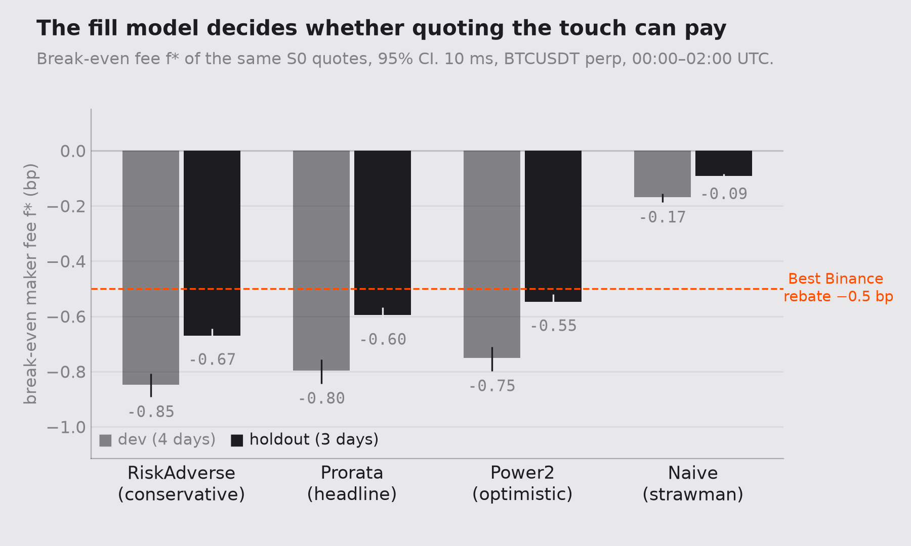
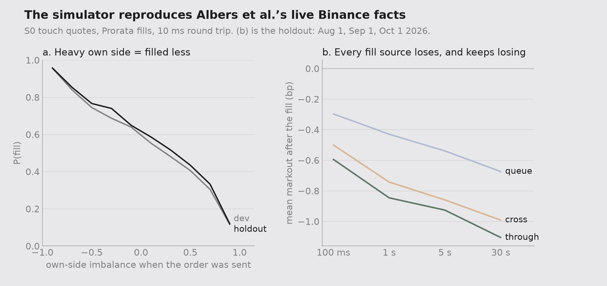
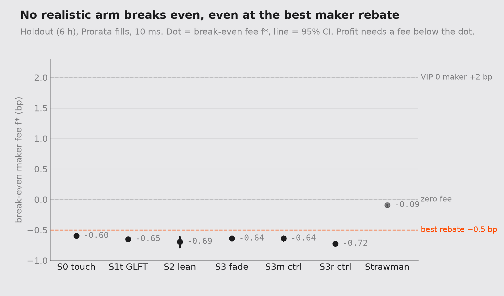

# market-making-simulator

A C++20 maker backtester for Binance BTCUSDT perpetuals, built on the verified L2 book from
[l2-orderbook-replay](https://github.com/Rubin-S/l2-orderbook-replay) (pinned at `engine/`).
Checked fill for fill against hftbacktest 2.4.4, then used for a pre-registered study with a
one-shot holdout.

**Headline.** On the holdout, every realistic quoting strategy loses money, even at Binance's best
maker rebate (−0.5 bp). The touch strategy's break-even maker fee is **f\* = −0.60 bp [−0.63, −0.57]**:
you'd have to be *paid* 0.6 bp per fill to break even. The only strategy that looks profitable is
the strawman with naive fills (+0.38 bp per fill at the rebate). **Whether market making looks
profitable is decided by the fill model, not the strategy.**

- **8 of 11** pre-registered hypotheses confirmed on the holdout. The mechanics replicate; the one strategy edge seen on dev (S3, fading imbalance) does not.
- Every run's P&L splits exactly into spread capture + markout + inventory − fees (198/198 holdout runs, 264/264 dev).
- Honest post-mortem written before this section: [`POSTMORTEM.md`](POSTMORTEM.md).
- Plain-words guide to the theory, with interview Q&A: [`LEARNING.md`](LEARNING.md).

| | |
|---|---|
| Engine | `make test`: 4 C++ test programs pass. Compat mode matches hftbacktest in **16/16 configs** (identical fills, equity within 1e-11 USDT). Own mode reproduces **97.5–98.9%** of hftbacktest's fills. |
| Data | Tardis free first-of-month files. Dev: Apr–Jul 2026 (8 h). Holdout: Aug 1, Sep 1, Oct 1 2026 (6 h), run once. **Each file covers 00:00–02:00 UTC only.** |
| Tags | `prereg-v1` … `prereg-v1.5` (pre-registration + addenda), `freeze-v1` (52e6887), `holdout-v1` (d97f5b2), `v1.0` |

## Results

Headline settings throughout: Prorata queue rule, 10 ms round trip, exchange-time clock. Numbers in
brackets are 95% CIs from a 5-minute moving-block bootstrap (2,000 resamples). "bp" = basis points
of traded notional, per fill.

### Q1. How much does the fill rule move the answer? A lot.



The same S0 quotes (1 lot at best bid and best ask) under four fill models:

| Fill model | Break-even fee f\*, dev | f\*, holdout |
|---|---|---|
| RiskAdverse (conservative) | −0.85 | −0.67 |
| **Prorata (headline)** | **−0.80** | **−0.60** |
| Power2 (optimistic) | −0.75 | −0.55 |
| Naive strawman | −0.17 | −0.09 |

The three queue models stay within about 0.1 bp of each other, and all three sit below the −0.5 bp
rebate. The naive model (fill whenever a trade prints at your price) gives about 4.5× as many fills
and shrinks the break-even gap 4–7×, which is enough to make the strategy look profitable at the rebate.
Holdout S0 fill rate is **0.559** [0.545, 0.572], inside the 45–65% that Albers et al. measured live.

### Q3. How big is adverse selection? It's the whole story.



| Holdout check | Result |
|---|---|
| Fill probability falls as your own side gets heavier (logit slope) | **−0.412** [−0.426, −0.395] |
| Bid fills when the next 5 s go down, minus when they go up | **+0.770** [0.733, 0.814] |
| Mean 1 s markout of a maker fill | **−0.594 bp** [−0.627, −0.566] |
| Large queues: front-of-queue minus back-of-queue markout | **+0.556 bp**, same sign on all 4 rules |
| Best queue-size × position cell | **−0.378 bp**: no cell makes money |

You get filled mostly when the price is about to move through you. Every fill source (queue,
trade-through, cross) loses at every horizon from 100 ms to 30 s, and trade-through fills are the worst.
The simulator reproduces all of Albers et al.'s live Binance facts without being tuned to them.

### Q5. What fee would each strategy break even at? Below every real tier.



| Arm (holdout) | f\* (bp) | Net per fill at −0.5 bp rebate |
|---|---|---|
| S0 touch | −0.60 [−0.63, −0.57] | −0.34 |
| S1t GLFT (touch-anchored) | −0.65 | −0.39 |
| S2 lean with imbalance | −0.69 | −0.27 |
| S3 fade imbalance | −0.64 | −0.44 |
| S3m random-direction control (same churn) | −0.64 | −0.39 |
| S3r random-direction control | −0.72 | −0.44 |
| Strawman (naive fills) | −0.09 | **+0.38** |

f\* is spread capture + 1 s markout per fill, before fees. A strategy profits only if its maker fee is
below f\*. Binance's best public maker rate is −0.5 bp, so no realistic arm clears it. At the retail VIP-0 fee (+2 bp), S0 loses 2.84 bp per fill.

### Q4. Does skewing on order-book imbalance help? No.

| Comparison (holdout, net bp per fill) | Dev | Holdout | Verdict |
|---|---|---|---|
| S3 (fade) − S3r (random direction), pre-registered | +0.181 [0.091, 0.258] | **+0.002** [−0.152, 0.151] | not confirmed |
| S3 − S3m (random direction, same churn), post-hoc | +0.097 [−0.006, 0.204] | −0.044 [−0.204, 0.115] | no edge |
| S2 (lean with) − S0 | −0.119 [−0.460, 0.276] | +0.070 [−0.429, 0.480] | too few fills to tell |

The dev "edge" of S3 over S3r came mostly from S3r being a worse-run order manager: it flipped sides
about 2.9× as often, so it kept losing its queue place. The churn-matched control S3m (added after
dev, disclosed in Addendum A5) already shrank the edge to a CI touching zero, and on the holdout it
is gone. S2 leans its quotes onto the heavy side, so it rarely fills (178 fills/h vs S0's 1,361);
its CI is too wide to say anything.

### Q2. Does GLFT inventory control help? Only as a cap.

γ was chosen by risk alone (the smallest γ that keeps the 99th-percentile |position| ≤ 10 lots on dev),
never by P&L: γ = 1e-6. At that γ, GLFT's skew is about 0.15 ticks per lot, far less than the one-tick
spread, so it rarely moves a quote. Inventory is really controlled by the hard wall: the strategy stops
quoting the side that would push |q| past about 9.7 lots. The literal GLFT rule (S1) never quotes at all,
because Binance's queue intensity does not decay exponentially with distance (H-C1 confirmed:
k12 − 0.5·k01 = −0.141 [−0.153, −0.128]). S1t (touch-anchored GLFT) breaks even at −0.65 bp, close to S0's −0.60.

### Latency (H-L1): not confirmed, and the metric was flawed

Going from 0 to 50 ms was predicted to hurt the cancel-using arms more than S0, in USDT per hour.
On the holdout, S1t's extra cut was +0.168 USDT/h [−0.172, 0.557]: not confirmed. Per-hour P&L
rewards trading less, so an arm that barely trades looks latency-proof (S1, with 0 fills, would
"pass"). This weakness was written down before the holdout; v2 measures latency per fill.

### All 11 hypotheses (holdout)

| Hypothesis | Holdout | Verdict |
|---|---|---|
| H-Q1a fill rate in [0.45, 0.65], RiskAdverse < Power2 | 0.559; −0.057 | ✅ |
| H-Q1b imbalance slope < 0 | −0.412 | ✅ |
| H-Q3a 1 s markout < 0 | −0.594 bp | ✅ |
| H-Q3b fill-direction gap ≥ 0.4 | 0.770 | ✅ |
| H-Q3c large-queue front beats back (all 4 rules) | +0.556 bp | ✅ |
| H-Q3d no positive cell | max −0.378 bp | ✅ |
| H-Q3e S0 needs a rebate (f\* < 0) | −0.596 bp | ✅ |
| H-Q4a S2 no better than S0 | +0.070 [−0.429, 0.480] | ❌ underpowered |
| H-Q4c S3 beats S3r by > 0.1 bp, loses at VIP-0 | +0.002 [−0.152, 0.151] | ❌ |
| H-L1 latency hurts cancel-users more | S1t +0.168 [−0.172, 0.557] | ❌ |
| H-C1 queue intensity is not exponential | −0.141 | ✅ |

Holm-adjusted p-values: 0 for every confirmed hypothesis, 1.000 for H-Q4a and H-Q4c, 0.436 for H-L1.

### Limitations

- **Asian session only.** Every file covers 00:00–02:00 UTC: 8 dev hours and 6 holdout hours. US/EU hours may differ.
- **The holdout was quieter.** S0 traded about a third as many fills per hour as on dev, and lost less per fill (f\* −0.60 vs −0.80). Every confirmed direction held anyway.
- **Simulated queue position.** Binance doesn't publish order-level data, so queue position comes from a probabilistic model. That's why four rules bracket the answer.
- **1 lot, no market impact.** Our 0.001 BTC orders don't change the book. Larger size would likely do worse.
- **S1t stands in for S1**, and S4 (reversal-gated) was not built in v1.

### v2 (pre-registered in POSTMORTEM.md, new days only)
Full 24 h days (Nov 2026 – Jan 2027), latency measured per fill, S4 reversal-gated arm, imbalance tested at 5 s and 30 s, and enough S2 hours for a useful CI.

## Reproduce

```bash
git clone --recursive https://github.com/Rubin-S/market-making-simulator && cd market-making-simulator
make && make test
python -m venv .venv && .venv/bin/pip install -r requirements.txt
# dev, in the order used in the study
for s in run_probes calibrate albers choose_gamma run_arms markouts economics verdicts; do .venv/bin/python research/$s.py; done
# holdout (refuses unless HEAD descends from freeze-v1 and the tree is clean)
for s in run_probes albers run_arms markouts economics verdicts; do .venv/bin/python research/$s.py --holdout; done
.venv/bin/python research/figures.py
```

---

## Pre-registration (prereg-v1, 2026-10-19)

Written and tagged **before any strategy arm is run on any day**. Nothing below changes after this
tag. A change becomes a dated addendum, or a v2 pre-registration on new days.

### Disclosure: what was run before this tag
- **2026-07-01 (dev):** S0 naive touch smoke runs at 0 and 50 ms, to check the mechanics (fill counts, P&L identity).
- **2026-10-01 (holdout):** first 10 minutes only, used for the hftbacktest oracle and mechanics checks. Fill sets were compared. **No P&L from this day was used for any decision.** The one engine change it led to ("act once per timestamp") is a mechanics fix that was found by comparing fills, not P&L.
- No strategy arm other than S0 has been run on any day.

### Data
- Tardis free first-of-month files, Binance USDT-M BTCUSDT (`incremental_book_L2` + `trades`).
- **Dev:** 2026-04-01, 05-01, 06-01, 07-01. **Holdout:** 2026-08-01, 09-01, 10-01. The holdout is run **once**, after `freeze-v1`.
- Burn-in: the first 60 s of each day. Mask: fills within ±30 s of each funding time (00:00, 08:00, 16:00 UTC) are excluded from statistics.
- Depth cadence is 52 ms in Apr/May and 26 ms from June on, so results are also reported per regime.
- Order size: 1 lot = 0.001 BTC (the exchange minimum). Tick 0.1 USDT.

### Questions
- **Q1** How much does the fill rule move the answer? Compare the same quotes under 4 queue rules plus a naive strawman.
- **Q2** Does inventory-aware quoting (GLFT) control risk better than naive touch quoting?
- **Q3** How large is adverse selection on maker fills? Markouts by horizon, fill source, queue size and position.
- **Q4** Does skewing quotes on order-book imbalance help, either with the signal or against it?
- **Q5** What maker fee would each strategy break even at, compared with Binance's fee tiers?

### Simulator settings
- **Queue rules:** RiskAdverse ≤ Power3(2) ≤ Prorata = Power(1) ≤ Power2(2), plus the naive strawman. **Headline = Prorata.** RiskAdverse and Power2(2) are reported as the conservative and optimistic bounds.
- **Fill sources:** queue, through, cross. A level that vanishes gives no fill. Post-only (GTX) orders are rejected when they would cross.
- **Latency ladder (round trip, entry = response = half):** 0 / 10 / 50 ms. **Headline = 10 ms**, roughly a bot in the exchange's cloud region. 0 ms is an upper bound only and is physically impossible. 50 ms is a slower setup.
- **Clock:** Tier A (exchange timestamp, no feed latency) is the headline. The strategy acts once per timestamp, on the finished book.

### Arms
| Arm | Quote rule | α̂ (alpha, ticks) |
|---|---|---|
| S0 naive touch | 1 lot at the best bid and the best ask | none, no inventory term |
| S1 GLFT | Rule A, below | 0 |
| S2 with-imbalance | Rule A | +κ·G*(I) |
| S3 contrarian | Rule A | −κ·G*(I) |
| S3r random | Rule A | ±κ·G*(I), sign by coin flip per decision (seed 20261020), the control for H-Q4c |
| Strawman | S0 quotes under the naive trade-through fill rule | none |
| S4 reversal-gated | stretch only; if not built, it moves to v2 | |

**Rule A (discretised GLFT).** With half-spread h = c1 + ½σc2 and skew s = σc2 (GLFT infinite-horizon closed form), the distance behind best in ticks is
z_b = (h − ½) + s·q − α̂ for the bid and z_a = (h − ½) − s·q + α̂ for the ask.
- z ≤ 0.5 → quote at touch; z ≤ 1.5 → one tick back; otherwise don't quote that side.
- **Hysteresis:** cancel/re-post only when the target level changes.
- **Q_max = 10 lots** (0.01 BTC) hard cap on |position|, for every arm.
- **Fees stay out of the quote rule** and are charged in P&L only.

### Calibration (dev days only, frozen to `config/calib_dev.json`, hash recorded at `freeze-v1`)
- σ: signature plot from 100 ms to 30 s; take the shortest flat horizon.
- A, k: probe orders at 0/1/2 ticks behind best, for each queue rule and latency. λ = fills / exposure time, Poisson MLE; level 2 is the fit check.
- G*: Stoikov microprice estimator (symmetrised). One shrink κ is chosen on dev.
- **γ: the smallest γ whose 99th-percentile |q| ≤ Q_max on dev. Never chosen by P&L.**

### P&L and markouts
- Exact identity on every run (to 1e-9): **P&L = spread capture + markout(τ) + inventory − fees.**
- Markouts at 100 ms / 1 s / 5 s / 30 s from the mid just before the fill. Horizons past the data end are dropped, not clipped.
- **τ\* = 1 s** for the split and for the break-even fee f\* = Σ(SC + MO(τ\*)) / Σ m0 × 10⁴ bp.
- **Fees:** VIP-0 (0.02% maker / 0.05% taker) is the headline. Also reported at 0 fee and at the −0.5 bp rebate tier.

### Hypotheses (signs fixed now)
**Confirmed** means the 95% CI is on the predicted side **on the holdout**, under the headline settings (Prorata, 10 ms). Bounds are reported alongside.
- **H-Q1a** S0 probe fill rate (fills / (fills + cancels), 1-lot touch order, cancel only when price moves away) is in [0.45, 0.65], and RiskAdverse < Power2(2).
- **H-Q1b** the imbalance coefficient in a logistic model of fill probability is < 0.
- **H-Q3a** mean 1 s markout of S0 maker fills is < 0, before fees.
- **H-Q3b** for bid probes, P(fill | 5 s mid return < 0) − P(fill | 5 s mid return > 0) ≥ 0.4 (mirrored for asks).
- **H-Q3c** in large queues, front-of-queue fills have better 1 s markouts than back-of-queue. Labelled "model-dependent" unless all 4 rules agree.
- **H-Q3d** no queue-size × position cell has a positive mean 1 s markout.
- **H-Q3e** S0 needs a rebate to break even (f\* < 0).
- **H-Q4a** S2 (with-imbalance) is no better than S0 in net P&L per fill.
- **H-Q4c** S3 beats S3r by > 0.1 bp per fill but still loses at VIP-0.
- **H-L1** going from 0 to 50 ms cuts gross P&L per hour more for S1-S3 (cancel-using) than for S0.

### Statistics
- **Primary CI:** 5-minute moving-block bootstrap, resampled within each day, **2,000 resamples, seed 20261020**.
- **Also shown:** day-block bootstrap. With 3 holdout days it is too coarse to gate on alone.
- All 10 hypotheses are reported, confirmed or not; none is dropped. Holm-adjusted p-values are shown as a secondary column.
- All reportings include inventory variance, Sharpe with error bars, max drawdown.

### Order of work after this tag
calibrate (dev) → Albers replication (dev) → arms + economics (dev) → README addendum + `freeze-v1` → holdout **once** → `holdout-v1` → write-up → `v1.0`.

### Addendum A1 (2026-10-19, before any strategy arm or P&L)
**What we had seen:** only the dev probe intensities in `results/probes_dev.csv` (Step 5a). No arm run, no P&L, no markouts.

**Evidence:** at the headline (Prorata, 10 ms), pooled over the 4 dev days, lambda = 0.781 / 0.611 / 0.591 fills per resting second at 0 / 1 / 2 ticks behind best. The decay is k01 = ln(l0/l1) = 0.245 per tick but k12 = 0.033, about 7x flatter, under every queue rule and latency. The exponential intensity A e^(-k d) behind GLFT does not fit this one-tick-spread market. With k = 0.245, GLFT's half-spread is about 1/k = 4 ticks, so Rule A would skip both sides almost always.

**Change:**
- **S1 GLFT stays exactly as pre-registered** and is reported. If it barely quotes, that is a result.
- **New quote rule, Rule T (touch-anchored GLFT):** z_b = s*q - alpha, z_a = -s*q + alpha, with the same thresholds (0.5 / 1.5), hysteresis and Q_max. s is GLFT's skew, computed with A = l0 and k = k01 from the probes. When flat, it quotes at the touch. Inventory and the imbalance tilt move it back.
- **New arm S1t** = Rule T with alpha = 0. **S2, S3 and S3r now use Rule T.** gamma is chosen as before (inventory rule, never P&L).
- **New hypothesis H-C1:** on the holdout probes (Prorata, 10 ms), k12 < 0.5 x k01. Exponential decay would give k12 = k01.

### Addendum A2 (2026-10-19, written before calibrate.py was run on any day)
**Microprice fallback rule, fixed in code before seeing its output.** On BTCUSDT the mid can move several ticks between two depth updates, so Stoikov's Markov sum for G* may not settle. `research/calibrate.py` therefore reports G* with a convergence check (terms < 1e-6 within 200 iterations, and |G*| < 1 tick). If it converges, alpha = kappa x G*(I). If it does not, alpha = kappa x G_tau(I), where G_tau(I) = E[mid(t+1 s) - mid(t) | I] on the dev days, symmetrised. Either way kappa is the least-squares fit of the 1 s mid change, never P&L.

### Addendum A3 (2026-10-19, data coverage, before any strategy arm or P&L)
`research/check_bbo.py` shows each dev file covers **00:00:00 to 01:59:59 UTC only (2.00 h)**, not a full day. These are the windows the OFI project downloaded. The clock is healthy: median gap 52 ms (Apr/May) and 26-28 ms (Jun/Jul), max gap 5.8 s. So:
- The sample is the **first 2 h UTC of each first-of-month day**: 8 h of dev, and 6 h of holdout if the holdout files match (checked by span only, before freeze).
- All rates (lambda, sigma, P&L per hour) are per second of data, so the calibration stands unchanged (`config/calib_dev.json`, sha256 c296b6f0...).
- Only the 00:00 UTC funding time falls inside the window, and the 60 s burn-in already covers it.
- **Limitation, stated up front:** 00:00-02:00 UTC is mostly the Asian session. Results may not carry over to the US/EU hours. Full-day replication is pre-registered as v2.

### Addendum A4 (2026-10-19, before any GLFT arm is run on any dev or holdout day)
**What we had seen:** the S0 Albers replication on dev (`results/albers_*_dev.csv`, all 8 checks pass). No GLFT arm (S1, S1t, S2, S3, S3r) has been run on a dev or holdout day. The arm code was only checked for mechanics on the disclosed 10-minute Oct 1 oracle slice, using placeholder calibration values; nothing from that check is used.
- **GLFT units** (`sim/include/mm/glft.hpp`): ticks, lots (Δ = 1), seconds. c1 = ln(1 + γ/k)/γ, c2 = sqrt(γ/(2Ak) · (1 + γ/k)^(k/γ + 1)), h = c1 + σc2/2, s = σc2. σ from `config/calib_dev.json`; A = λ0 and k = k01 from the probes for the **same queue rule and latency as the run**.
- **q** = the position the strategy has heard about (fills reach it one response latency later). Q_max = 10 stays a hard cap in every arm run.
- **α** = κ · G_tau[bin], with I = bid / (bid + ask) at the best level and bin = min(⌊10·I⌋, 9) (alpha source g_tau, Addendum A2). S2 uses +α, S3 uses −α, S1 and S1t use 0.
- **S3r:** a fresh coin flip (seed 20261020) each time the imbalance bin changes, which is the only event that changes S3's α. Flipping on every timestamp made S3r cancel about 10x more often than S3 in the mechanics check, so it would have measured churn and lost queue position, not direction.
- **γ rule, made exact** (`research/choose_gamma.py`): arm S1t, Prorata, 10 ms. The Q_max cap is **lifted** during selection (with the cap on, |q| can never pass 10, so every γ would pass). |true position| is time-weighted (after burn-in, outside funding) and pooled over the 4 dev days. Grid γ = 10^(−8 + j/3), j = 0..15. Pick the smallest γ with p99 |q| ≤ 10. If none passes, report it; don't widen the grid. **One γ is used for every arm, queue rule and latency.** The script reads inventory only, never fills or P&L. The result is frozen in `config/gamma_dev.json` with its sha256.

### Addendum A5 (2026-10-19, after the Step 7 dev arm runs, before any holdout run)
**What we had seen:** every dev arm result in `results/arms_dev.csv` and `results/markouts_dev.csv` (commit 4e542e5), including S3 vs S3r. No holdout day has been run.
- **Problem:** S3r was meant to have the same quote churn as S3. It doesn't. At Prorata 10 ms its fills / (fills + cancels) is 0.243 against S3's 0.622, so roughly 2.9x the cancels. S3 swaps which side leans back only when the **sign** of G_tau[bin] changes. A fresh coin on every bin change swaps sides far more often. So S3 vs S3r mixes direction with churn, which is what S3r was supposed to remove.
- **Added arm S3m:** the same as S3r, except the coin is re-flipped only when the sign of G_tau[bin] changes (same seed, 20261020). S3m swaps sides exactly when S3 does. Its direction is random, and with coin = -1 it is identical to S3.
- **How it's reported:** S3 vs S3r stays the pre-registered comparison and is reported as written. S3 vs S3m is added as a **post-hoc** control, labelled as chosen after seeing dev results, and reported beside it on dev and holdout. Nothing else changes: calibration, gamma, the other arms and the holdout plan are untouched.

### Addendum A6 (2026-10-19, before any confidence interval or bootstrap has been computed, on dev or holdout)
**What we had seen:** the dev point estimates in `results/arms_dev.csv` and `results/markouts_dev.csv` (Steps 7 and 7b). No CI, p-value or holdout number exists yet.
- **Unit:** one minute of one day. `mm_sim` writes `pnl_min.csv`: mark-to-market equity after fees at t_start, at every whole UTC minute after it, and at the data end (final mid). For each unit, fills, notional, SC, 1 s markout and fees come from that minute's fills. INV = equity change − SC − MO + fees, i.e. the price move on the position held. The units add up exactly to each run's total P&L, and this is checked on every run.
- **Primary CI (the README's 5-minute moving-block bootstrap, made exact):** blocks of 5 consecutive minutes, block starts drawn uniformly, resampled within each day to that day's length. 2,000 resamples, seed 20261020, 95% percentile intervals. The **same draws are used for every run**, so differences between arms (S3 − S3r, S2 − S0, H-L1) are paired. One-sided p = the share of resamples on the wrong side of the threshold.
- **Day-block bootstrap:** resample whole days with replacement, same seed, shown beside the primary CI.
- **Per hour** = minutes after burn-in / 60 (funding minutes included, as they are in total P&L). **Sharpe** = mean / sd of 1-minute net VIP-0 P&L × √60 (hourly; never annualised from a 2-hour Asian-session window). **Max drawdown** = worst intraday drop of net VIP-0 equity at 1-minute resolution. **Inventory** = time-weighted mean q² (lots²) from `inv_hist.csv`.
- **H-L1 test:** cut(arm) = gross USDT/h at 0 ms − gross USDT/h at 50 ms. Predicted: cut(arm) − cut(S0) > 0 for S1, S1t, S2 and S3. S1 never quotes, so it is reported as not testable.
- **Holm** adjustment across all 10 hypotheses is computed once, in the holdout report. Dev output is labelled a preview and is never used to confirm anything.
### Addendum A7: freeze-v1 (2026-10-19, after every dev result, before any holdout run)
**What we had seen:** all dev results, including the CIs in `results/economics_dev.csv` and `results/hypotheses_dev.csv` (Step 8, commit 83f2b53) and the dev preview in `results/verdicts_dev.csv`. No holdout day has been run.
- **Frozen:** engine bd7882f, `config/calib_dev.json` (sha256 c296b6f0…), `config/gamma_dev.json` (sha256 88ea8552…, γ = 1e-6), every arm and its parameters, the headline (Prorata, 10 ms, Tier A), the 5 fill rules, the 0/10/50 ms ladder, and fees. Nothing is recalibrated on the holdout.
- **Holdout days:** 2026-08-01, 2026-09-01, 2026-10-01, each 00:00–02:00 UTC (6 h). Run once, in this order: `run_probes.py`, `albers.py`, `run_arms.py`, `markouts.py`, `economics.py`, `verdicts.py`, all with `--holdout`. The scripts refuse to start unless freeze-v1 is in the checkout and the code is committed.
- **Verdicts (`research/verdicts.py`):** every hypothesis gets a 95% CI from the A6 bootstrap (orders count in the minute they were sent, fills in the minute they happened). Confirmed = the CI is on the predicted side. A hypothesis with several parts needs all of them, and its p is the largest part p. Holm runs over 11 hypotheses (the 10 in the README + H-C1).
  - H-Q1a = headline fill rate inside [0.45, 0.65] **and** riskadverse − power2 < 0.
  - H-Q3c is labelled model-dependent unless large-queue front − back > 0 holds on all 4 rules.
  - H-Q3d = the largest mean 1 s markout over the cells with n ≥ 30 is < 0.
  - H-C1 = k12 − 0.5·k01 < 0, with probe resting time spread evenly over minutes.
- **H-L1 parts are S1t, S2 and S3.** S1 never quotes and is reported as not testable. S1t is Addendum A1's touch-anchored stand-in for S1. Known weakness, written down before the holdout: H-L1 is measured in USDT per hour, so an arm with few fills "passes" just by losing little. It is reported as written, and its weakness is discussed in the write-up.
- **S3m (A5)** is reported beside S3r and kept out of Holm. Any fix after the holdout is a v2 pre-registration on new days, never an edit to v1.
